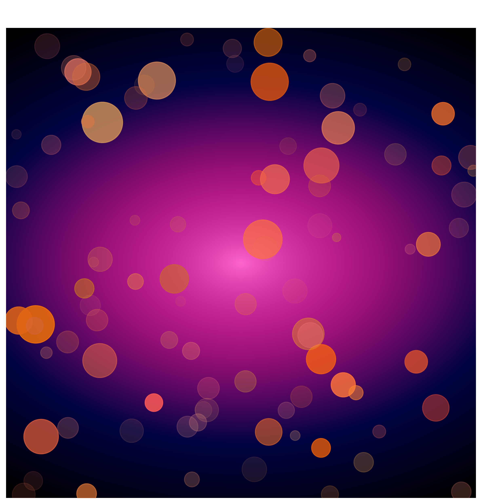

# Quantum Symphony 🎵

A student project exploring the connection between quantum computing, visual art, and music using Python and Qiskit.

## About

Quantum Symphony uses simulated quantum circuit measurement results as inputs for two creative experiments:

- **Quantum Radiance:** Generates abstract artwork using Matplotlib and NumPy.
- **Quantum Aurora:** Maps measured bitstrings to musical notes and synthesizes tones using NumPy and Pygame.

The project explores how quantum measurement outcomes can inspire creative applications.

## How It Works

1. A five-qubit quantum circuit applies Hadamard gates.
2. The circuit is executed on a Qiskit Aer simulator.
3. The measurement results are used to create visual patterns and a sequence of musical notes.
4. Python's random module adds further variation to the artwork and musical accompaniment.

The artwork and music use separate circuit executions. Some creative choices are generated using classical randomness, so not every element is directly determined by quantum measurement.

## Technologies

- Python
- Qiskit
- Qiskit Aer
- NumPy
- Matplotlib
- Pygame

## Requirements

- Python 3.10 or newer
- A working Python environment
- Audio output for the music component

## Setup

Clone the repository:

```bash
git clone YOUR_GITHUB_REPOSITORY_URL
cd quantum-symphony
```

Create a virtual environment:

```bash
python -m venv .venv
```

Activate it on Windows:

```powershell
.venv\Scripts\Activate.ps1
```

On macOS or Linux:

```bash
source .venv/bin/activate
```

Install the dependencies:

```bash
python -m pip install -r requirements.txt
```

## Run

```bash
python quantum_symphony.py
```

The program generates an abstract artwork image and plays a synthesized melody. It requires a graphical display and working audio output.

## Example Output



## Notes

This project uses a quantum circuit simulator rather than physical quantum hardware. The output is a creative demonstration, not a benchmark of quantum advantage.

## Authors

Pavana G., Hamsa, and Tanushree

## License

No license has been assigned yet. Please contact the authors before reusing or redistributing the code.
